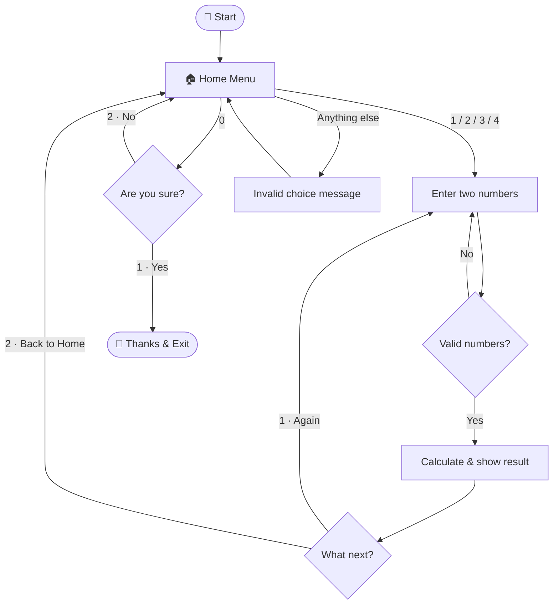

<div align="center">


<a href="https://git.io/typing-svg">
  
</a>

<br/>


</div>

---

## 🧮 About

**Console Calculator** is a menu-driven command-line application written in C#. It performs the four basic arithmetic operations, validates every input, and lets the user stay inside an operation to calculate repeatedly or return to the main menu at any time.

It was built as the Week 1 mini project of my C# learning journey, applying variables, operators, `switch`, loops, and methods in one real program.

### 🗓️ Project Timeline

|     |                  |                  |
| --- | ---------------- | ---------------- |
| 🚀  | **Started**      | 30 October 2026  |
| 🔄  | **Last updated** | 07 November 2026 |
| 📦  | **Version**      | 1.0.0            |

---

## ✨ Features

|     | Feature                   | Description                                              |
| --- | ------------------------- | -------------------------------------------------------- |
| ➕  | **Four operations**       | Addition, subtraction, multiplication and division       |
| 🔁  | **Stay or go home**       | After each result, choose _"again"_ or _"Back to Home"_  |
| 🛡️  | **Input validation**      | Letters, blanks or malformed numbers never crash the app |
| 🚫  | **Divide-by-zero guard**  | Friendly error instead of an exception                   |
| ✅  | **Exit confirmation**     | Asks _"Are you sure?"_ before closing                    |
| 🎯  | **Precise results**       | Uses `decimal`, so `0.1 + 0.2 = 0.3`                     |
| ✂️  | **Clean division output** | Results rounded to 4 decimal places (`10 / 3 = 3.3333`)  |
| 🧱  | **Overflow protection**   | Extremely large results show an error, not a crash       |

---

## 🖥️ Preview

```text
===== Calculator =====
1. Add
2. Subtract
3. Multiply
4. Divide
0. Exit
Choose an option: 4
```

```text
===== Divide =====
Enter first number: 10
Enter second number: 3
Result: 3.3333

1. Divide again
2. Back to Home
Choose an option:
```

<details>
<summary><b>🛡️ See how invalid input is handled (click to expand)</b></summary>

<br/>

**Letters instead of a number**

```text
Enter first number: abc
Invalid number! Please enter a valid number (e.g. 10 or 2.5).
Enter first number:
```

**Division by zero**

```text
Enter first number: 10
Enter second number: 0
Error: Cannot divide by zero.
```

**Wrong menu option**

```text
Choose an option: 9

Invalid choice! Please choose 0, 1, 2, 3 or 4.
Press any key to try again...
```

**Exit confirmation**

```text
Choose an option: 0

Are you sure you want to exit?
1. Yes, exit
2. No, back to Home
Choose an option:
```

</details>

---

## 🔄 Program Flow



---

## 🚀 Getting Started

### Prerequisites

- [.NET SDK 6.0 or later](https://dotnet.microsoft.com/download)

### Run locally

```bash
# 1. Clone the repository
git clone https://github.com/YOUR_USERNAME/csharp-console-calculator.git

# 2. Move into the project folder
cd csharp-console-calculator

# 3. Run the app
dotnet run
```

> 💡 Using Visual Studio? Open the project and press **Ctrl + F5**.

---

## 📁 Project Structure

```text
csharp-console-calculator/
├── Program.cs      # All application logic
└── README.md       # Application documentations
```

<details>
<summary><b>🧩 Key methods in Program.cs (click to expand)</b></summary>

<br/>

| Method                 | Purpose                                                                                                |
| ---------------------- | ------------------------------------------------------------------------------------------------------ |
| `Main()`               | Runs the home menu loop and dispatches to each operation with `switch`                                 |
| `ReadNumber(prompt)`   | Keeps asking until the user enters a valid `decimal` (uses `decimal.TryParse` with `InvariantCulture`) |
| `AskAgain(actionName)` | Shows _"again / Back to Home"_ and validates the choice                                                |
| `ClearScreen()`        | Clears the console safely, even when output is redirected                                              |
| `WaitForKey()`         | Waits for a key press safely, even when input is redirected                                            |

</details>

---

## 📚 Concepts Practiced

<div align="center">


</div>

---

## 🗺️ Roadmap

- [x] Add, subtract, multiply, divide
- [x] Input validation and error handling
- [x] Exit confirmation

---

## 🤝 Contributing

Suggestions and improvements are welcome. Feel free to open an issue or submit a pull request.

1. Fork the project
2. Create your branch: `git checkout -b feature/amazing-feature`
3. Commit your changes: `git commit -m "Add amazing feature"`
4. Push to the branch: `git push origin feature/amazing-feature`
5. Open a Pull Request

---

## 📄 License

Distributed under the MIT License. See `LICENSE` for more information.

---

<div align="center">

**⭐ If you found this project helpful, consider giving it a star!**

Made with ❤️ and C#


</div>
